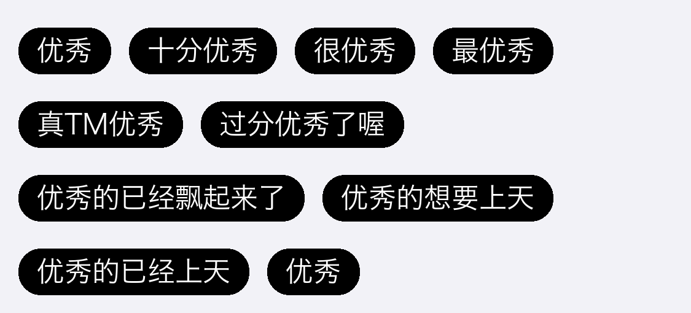
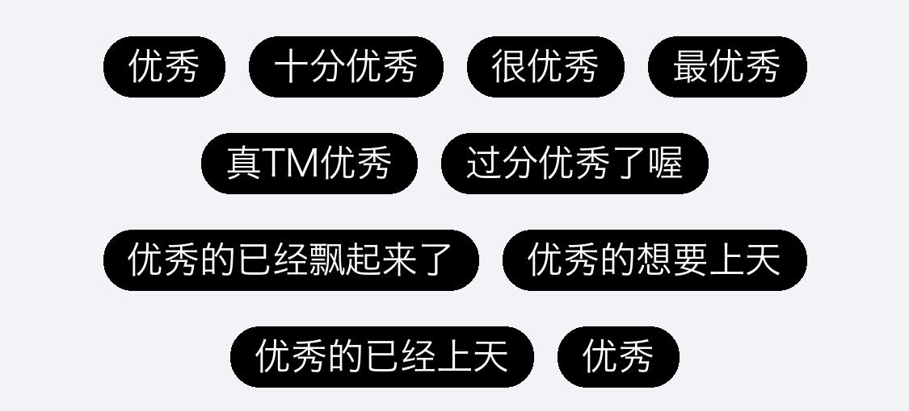

# TagsView

一个 Objective-C 写的 **iOS 标签流式布局控件**。

传给它一个字符串数组，它按屏幕宽度自动折行，把每个字符串排成圆角标签，并告诉你整块区域有多高——你只管 `addSubview`。

```objc
NSArray *tags = @[@"优秀", @"十分优秀", @"很优秀", @"最优秀", @"真TM优秀", @"过分优秀了喔",
                  @"优秀的已经飘起来了", @"优秀的想要上天", @"优秀的已经上天", @"优秀"];
```



> 上图不是截图，是按源码里的样式参数 1:1 渲染的（背景 `#000000`、字号 15pt、圆角 12pt、高 25pt、水平间距 10pt、行距 15pt），换到真机上视觉一致。

标签默认样式：**纯黑背景 + 白色文字**，圆角 12pt、字号 15pt、固定高 25pt，水平间距 10pt、行距 15pt。

> 代码里虽然写了 `layer.borderWidth = 1`，但**没有设置 `borderColor`**（CALayer 默认是黑色，与背景同色），所以看到的其实是没有描边的纯黑胶囊。

---

## 两个类，选一个就行

仓库里有两套实现，API 一模一样，区别只在一个：

| 类 | 布局方式 | 每行对齐 | 说明 |
| --- | --- | --- | --- |
| **`TagView`** | 标签直接挂在自己身上 | **左对齐** | 实现最简单，没有全局状态，**推荐优先用** |
| **`TagsView`** | 每行先套一个"行容器"，再把标签放进容器 | **整行居中** | 视觉上更整齐，但有一处全局变量的坑（见「已知限制」） |

看效果差异，同样是上面那组标签：

<table>
<tr>
<td align="center"></td>
<td align="center"></td>
</tr>
<tr>
<td align="center"><b><code>TagView</code></b><br>每行左对齐，第一个标签始终贴左边</td>
<td align="center"><b><code>TagsView</code></b><br>每行整体居中，左右留白相等</td>
</tr>
</table>

**不确定选哪个，就用 `TagView`。** 绝大多数场景（评价标签、筛选条件、兴趣标签）左对齐就够用，而且不会有下面说的崩溃风险。

---

## 安装

### 方式一：CocoaPods（推荐）

已发布到 CocoaPods 官方源，`Podfile` 里加一行：

```ruby
pod 'TagsView'
```

然后：

```bash
pod install
```

引入头文件：

```objc
#import <TagsView/TagView.h>    // 左对齐版本
// 或
#import <TagsView/TagsView.h>   // 居中版本
```

> **不需要**额外安装 MJRefresh 或 MJExtension。仓库里自带的 `UIView+MJExtension` 是内部用来自动算坐标的，已经一起打包进 pod 了。但**如果你的项目本来就在用 MJRefresh**，请先看文末的「已知限制」第 5 条。

### 方式二：手动拖入

把 `TagsView/` 下的文件拖进 Xcode：

```
TagView.h     TagView.m        ← 左对齐版本
TagsView.h    TagsView.m       ← 居中版本
UIView+MJExtension.h  UIView+MJExtension.m   ← 坐标计算，必须有
```

- 勾选 **Copy items if needed**
- 确认勾选目标 target
- 两个主类只拖你要用的那个也行，但 `UIView+MJExtension` **必须带上**，否则编译不过

手动拖入后这样引用：

```objc
#import "TagView.h"
```

---

## 快速使用

```objc
#import "TagView.h"

NSArray *tags = @[@"优秀", @"十分优秀", @"很优秀", @"最优秀", @"真TM优秀"];

// 1. 创建（布局在这一步就已经算完了）
TagView *tagView = [[TagView alloc] initWithTags:tags];

// 2. 问它需要多高
CGFloat height = [tagView tagViewHeight];

// 3. 设 frame —— 宽度用屏幕宽，因为内部就是按屏幕宽折行的
CGFloat width = [UIScreen mainScreen].bounds.size.width;
tagView.frame = CGRectMake(0, 100, width, height);

// 4. 加上去
[self.view addSubview:tagView];
```

三步的顺序**不能反**：`tagViewHeight` 必须在设 frame 之前调用，因为它是根据已经算好的标签位置反推出来的。

居中版本把类名和方法名换一下就行：

```objc
TagsView *tagsView = [[TagsView alloc] initWithTags:tags];
CGFloat height = [tagsView tagsViewHeight];   // 注意是 tagsViewHeight
```

---

## API

两个类都是 `UIView` 的子类，只有两个方法，没有代理、没有回调：

### `- (instancetype)initWithTags:(NSArray *)tags`

| 参数 | 类型 | 说明 |
| --- | --- | --- |
| `tags` | `NSArray<NSString *> *` | 标签文字数组。**必须是字符串**，元素数量不限 |

传入后立即完成排布。**不要**之后再改原数组——改了不会重新布局，需要重新 `init` 一个实例。

### `- (CGFloat)tagViewHeight` / `- (CGFloat)tagsViewHeight`

返回整块控件应有的高度，**单位 pt**，已包含最后一行下方的 15pt 间距。

空数组时返回 `0`，可以直接把父视图高度设成 0 来隐藏。

---

## 想改样式？改这几处

当前版本**没有对外暴露配置项**，样式是写死在源码里的。按下面的位置改，改完重新编译即可：

| 想改什么 | 改哪里 | 文件 |
| --- | --- | --- |
| 水平间距（默认 10） | `static const float tagMargin = 10.f;` | `TagView.m` / `TagsView.m` 顶部 |
| 行间距（默认 15） | `static const float verMargin = 15.f;` | 同上 |
| 标签高度（默认 25） | `label.mj_h = 25;` | `setupUI` 方法里 |
| 背景色（默认黑） | `label.backgroundColor = [UIColor blackColor];` | `tagLabelWithText:` |
| 文字色（默认白） | `label.textColor = [UIColor whiteColor];` | 同上 |
| 字号（默认 15） | `label.font = [UIFont systemFontOfSize:15];` | 同上 |
| 圆角（默认 12） | `label.layer.cornerRadius = 12;` | 同上 |
| 描边 | `label.layer.borderWidth = 1;` 加一行 `label.layer.borderColor = [UIColor whiteColor].CGColor;` | 同上。**只改 `borderWidth` 看不到效果，必须同时设 `borderColor`**——默认是黑色，跟背景一样 |
| 左右内边距 | `label.mj_w += 2 * tagMargin;` | `setupUI` 里，改 `2 *` 这个系数 |

标签宽度的算法很简单：先用 `sizeToFit` 量出文字宽度，再**加上左右各一个 `tagMargin`** 当内边距。

---

## 已知限制

这部分请一定看一眼，能省掉你几个小时的排查。

### 1. `TagsView` 里的 `row` 是全局变量（重要）

`TagsView.m` 里这一行：

```objc
NSInteger row = 0;      // 文件级全局变量，不是实例变量
```

`setupUI` 里 `row++`，但**从不重置**。后果：

- **同一个页面创建第二个 `TagsView`**，`row` 会从上一轮的值继续往上加，`self.tagLineViews[row]` 直接越界 → **崩溃**
- 同一个实例销毁重建，问题同样存在
- 传空数组（`tags.count == 0`）时，最后那行 `self.tagLineViews[0]` 也可能越界

**规避办法**：同一个 App 里只用 `TagView`（它没有这个变量），或者同时只保留一个 `TagsView` 实例。

**想根治**，把 `TagsView.m` 顶部的全局变量删掉，在类扩展里声明成实例变量，并在 `setupUI` 开头重置：

```objc
// 顶部：删掉 NSInteger row = 0;

// 类扩展里加上：
@property (nonatomic) NSInteger row;

// setupUI 开头加一行：
self.row = 0;

// 然后把方法里所有 row 改成 self.row
```

### 2. 宽度按屏幕算，不能放进窄容器

`setupUI` 里用的是 `[UIScreen mainScreen].bounds.size.width`，不是 `self` 的宽度。所以：

- 放在**半屏、侧边栏、卡片内部**时，会按全屏宽折行，视觉上溢出或排得特别稀
- **横竖屏切换不会重排**（没有监听方向变化）
- iPad 分屏 / Slide Over 下同样不准

真要用在非全屏容器里，把 `setupUI` 里的 `screenW` 换成构造时传入的宽度或 `self.superview` 的宽度，并在 `layoutSubviews` 里重新排一次。

### 3. 标签不可点击

`UILabel` 默认 `userInteractionEnabled = NO`，且没有暴露任何点击回调。要支持点击，得给每个 label 加 `UITapGestureRecognizer`，或者把 label 换成自定义 `UIControl`。

### 4. 浮点数精度

间距、宽度都是 `float`，在 3x 屏上偶尔会出现 0.5pt 的像素差导致描边发虚。想要严格对齐，把 `tagMargin` / `verMargin` 改成整数，并在算宽度时 `ceil` 一下。

### 5. 与 MJRefresh / MJExtension 同名分类冲突

`UIView+MJExtension` 里的 `mj_x / mj_y / mj_w / mj_h / mj_size / mj_origin`，和 MJRefresh、MJExtension 里的分类**同名**。

Objective-C 的 category 方法在运行时注册，同名会**互相覆盖**（后加载的生效），不会编译报错，但可能出现「某个属性忽然不生效」的怪问题。

**规避办法**：

- 如果项目已经在用 MJRefresh，**不要**引入本库，直接把 `mj_` 调用改成 `frame.origin.x`、`CGRectGetMaxX(...)` 这类原生写法（一共就 20 几行）
- 或者把本库的分类前缀改成 `tv_` 等不冲突的名字

---

## 环境要求

| 项 | 要求 |
| --- | --- |
| 平台 | iOS 8.0+ |
| 语言 | Objective-C（Swift 需桥接） |
| ARC | 是（podspec 里 `requires_arc = true`） |
| 依赖 | 无外部依赖，只用 Foundation / UIKit |
| 布局 | 纯 frame，**不使用 Auto Layout** |
| 集成 | CocoaPods（已发布 0.0.1）、静态库、源码直拖均可 |

Swift 项目要用的话，在桥接头文件里加：

```swift
// YourApp-Bridging-Header.h
#import "TagView.h"
```

---

## 项目结构

```
TagsView/
├── TagsView.h / .m              居中版本（每行套行容器）
├── TagView.h / .m               左对齐版本（推荐）
├── UIView+MJExtension.h / .m    坐标快捷属性（源自 MJRefresh，内部使用）
├── TagsView.podspec             CocoaPods 配置
└── LICENSE                      MIT
```

代码总量 384 行，没有第三方依赖，可以直接读源码理解每一处计算。

---

## License

MIT © 2018 812602984

可自由用于商业项目，保留版权声明即可。
